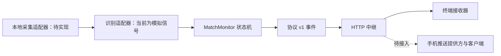

# 底层架构与实施边界

状态：可运行的基础参考实现，尚不可作为完整匹配提醒产品发布。

## 数据流

## 模块职责

| 目录 | 职责 |
| --- | --- |
| `packages/core` | 显式启动监控、连续信号确认、乱序过滤、每轮仅提醒一次 |
| `packages/protocol` | 版本化事件及运行时校验，禁止额外字段 |
| `services/relay` | 单组设备的开发中继，发布与接收分权、事件去重、容量与时效限制 |
| `apps/desktop-agent` | 模拟识别适配器与发送示例 |
| `apps/receiver` | 按游标轮询的接收示例 |
| `test` | 核心状态与 HTTP 链路验证 |

基础实现采用 Node.js 24 内建模块与 ESM，无第三方运行时依赖。当前没有 Rust、Tauri 或移动端空壳项目，避免把不可运行的目录当成已完成能力。后续可用 Rust 实现平台采集和桌面宿主，通过版本化消息接口与中继交互。

## 通用识别策略

首个真实适配目标是用户选择的窗口/屏幕区域，不依赖某一个游戏 API。采集端只读取操作系统授权的画面；识别端将模板、OCR 或视觉模型结果归一化为 `{confidence, observedAt}`。核心不关心游戏名称或具体图像算法。

默认置信阈值 0.9，2 次相邻高置信样本才产生事件，间隔超过 2 秒重新累计。低置信样本清空候选；忽略重复与乱序时间；每次 arm 创建新 session，直到重新 arm 前仅通知一次。这是防抖规则，不代表通用识别准确率已经达到发布标准。

下一步先实现手动选区 + 本地模板匹配与回放数据集，记录误报、漏报和延迟，再决定是否加入 OCR。窗口遮挡、分辨率缩放、语言、动画与全屏模式都要列入实测。禁止注入游戏进程、读取游戏内存或自动接受对局。

## 协议 v1

`POST /v1/events` 需要 publisher Bearer token，JSON 字段严格限定为：

| 字段 | 约束 |
| --- | --- |
| version | 1 |
| type | match.found |
| id / sessionId | UUID v4，重试复用同一 id |
| occurredAt | Unix 毫秒，距离中继时钟不超过 5 分钟 |
| confidence | 0 到 1 的有限数值 |

`GET /v1/events?after=0` 需要独立 receiver Bearer token，返回 `{events: [{sequence,event}], latest}`。接收端在消费完成后更新游标。游标已过期或大于当前序列返回 409，提示可能漏收，不保证补发。`GET /health` 不需要 token。

同一 id 在接收后 5 分钟内重复发送返回 200，首次返回 202；队列默认容量 1000，满时返回 503。最多 4 KiB 请求体。事件与去重记录只存内存，重启即丢失。当前没有持久化、跨实例协调、后台重试队列、接收确认或 exactly-once 保证。终端重复启动可能重新展示尚未过期的事件。

## 公开发布前的必要工作

1. 真实桌面采集、权限引导、选区预览及录制样本回放测试。
2. 手机客户端与 APNs/FCM 推送适配器；验证锁屏、后台、省电、离线和通知权限。终端轮询只能验证传输协议。
3. 一次性配对码、每设备可撤销凭证、安全存储、设备隔离；当前两个手动 token 仅服务一组开发设备。
4. 持久事件队列、确认/重试/TTL、限流、TLS、日志脱敏、指标与部署升级流程。当前只绑定 127.0.0.1，不直接暴露公网。
5. Windows 优先平台验证与签名安装包；随后评估 macOS、Linux。真实游戏画面默认仅在本地处理，上传只能包含提醒元数据。
